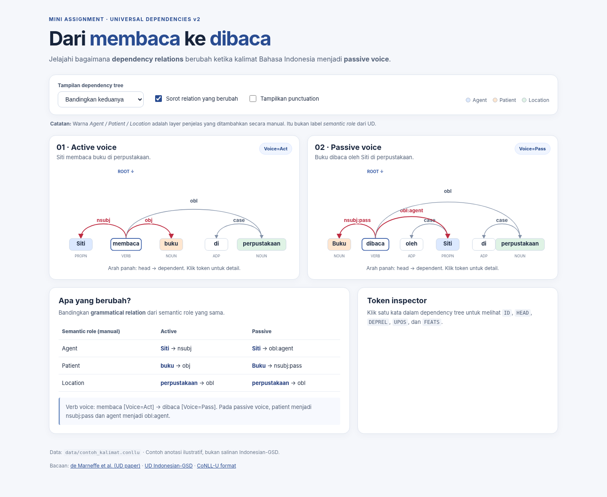
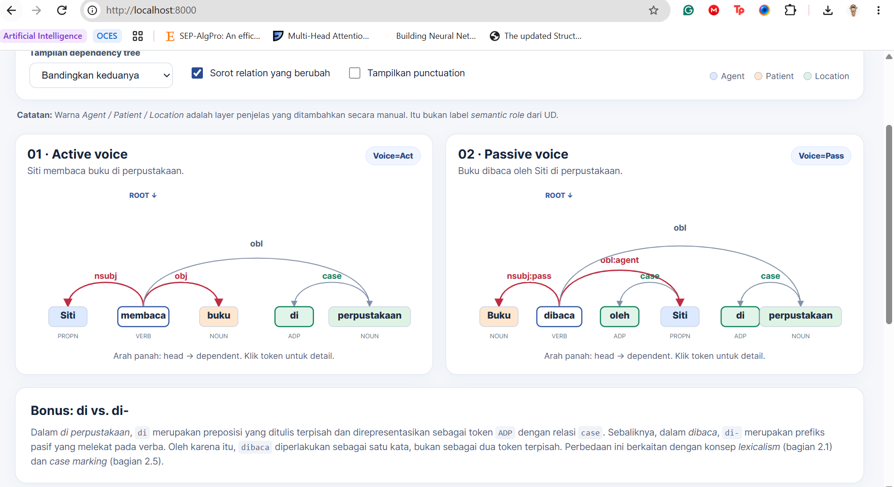

# Laporan Mini Assignment — Universal Dependencies Bahasa Indonesia

**Nama / Kelompok:** Kelompok 11 (Keiza dan Almer)  
**Kelas:** NLP - Probation Lab KC  
**Tanggal:** 27 Oktober 2026

## A. Ringkasan hasil

Dependency tree yang telah dibuat menjelaskan mengenai bagaimana setiap kata berhubungan di dalam suatu kalimat dan bagaimana kalimat aktif dan pasif akan memiliki struktur sintaks yang berbeda. Meskipun ada perubahan kalimat dari aktif ke pasif akan memiliki semantic role yang tetap sama walaupun sintaksisnya berubah. Visualiasi juga memperlihatkan bahwa di pada kata seperti "di perpustakaan" dan perfiks di- pada dibaca dinotasi berbeda walaupun memiliki bentuk yang mirip.

## B. Perbandingan *active–passive voice*
| Semantic role (interpretasi manual) | Active: token + `DEPREL` | Passive: token + `DEPREL` | Apa yang berubah? |
|---|---|---|---|
| Agent | Siti -> nsubj | Siti -> obl:agent |"Siti" yang awalnya merupakan nsubj atau subjek utama pada kalimat aktif, berubah menjadi obl:agent atau oblique di kalimat pasif. Oleh karena itu, "Siti" tidak lagi menjadi subjek yang wajib ada di dalam kalimat. Jika "Siti" dikeluarkan dari kalimat pasif tersebut, kalimat akan tetap memiliki struktur yang pantas (contoh: "Buku dibaca" akan masih menjadi kalimat yang utuh). Menanggapi hal ini, meski relasi sintaksisnya berubah, "Siti" tetap merupakan agent atau pelaku yang membaca dalam pemaknaannya.  |
| Patient | buku -> obj | Buku -> nsubj: pass | Pada kalimat aktif, "buku" merupakan objek yang dibaca oleh Siti. Kata "buku" tidak harus ditambahkan, karena tanpa kata "buku", telah terbentuk kalimat utuh "Siti membaca". Pada kalimat pasif, "buku" berubah menjadi subjek inti yang harus ada di dalam kalimat untuk membentuk kalimat yang utuh.  |
| Location | perpustakaan -> obl | perpustakaan -> obl |Kata "perpustakaan" tidak berubah di kedua kalimat, karena "perpustakaan" sendiri merupakan kata pelengkap yang menjelaskan lokasi.  |

## C. Jawaban analisis (200–300 kata total)

**C1.** Mengapa `buku` berubah dari `obj` menjadi `nsubj:pass`?

Pada contoh kalimat aktif, "buku" merupakan objek langsung atau obj, di mana objek ini merupakan argumen inti yang berhubungan dengan kata membaca (verba). Ketika kalimat diubah menjadi pasif, verba akan berubah sebagai subjek inti, sehingga kini merupakan unsur wajib. Tanpa "buku", kalimat akan terasa tidak lengkap. Label yang dipakai adalah nsubj:pass, bukan nsubj, karena buku sendiri adalah subjek dan bukan pelaku tindakan. Pada paper bagian 2.2, disebutkan bahwa label perlu menandai subjek pada non-canonical voice atau pasif. Secara makna di real-life, "buku" tetap patient, tetapi yang berubah hanya relasi sintaksisnya.

**C2.** Mengapa `Siti` berubah dari `nsubj` menjadi `obl:agent`?

Pada kalimat aktif, "Siti" merupakan nsubj karena merupakan subjek inti di mana kepaduan kalimat tidak akan utuh jika Siti dihilangkan (Siti berperan sebagai pelaku di dalam kalimat aktif). Sementara itu, Siti berubah menjadi obl: agent (oblique) pada kalimat pasif. Hal ini menyebabkan kata "Siti" menjadi tidak wajib untuk ditambahkan, karena hanya digunakan sebagai pelengkap. Jika kata "Siti" tidak ditambahkan pada kalimat pasif, kalimat akan masih utuh. Keterangan "agent" itu sendiri mengindikasikan Siti sebagai pelaku di kalimat tersebut.

**C3.** Mengapa `di` di “di perpustakaan” menjadi token `case`, tetapi `di-` pada “dibaca” tidak menjadi node sintaksis tersendiri?

Kata "di" pada kalimat "di perpustakaan" merupakan token case karena kalimat tersebut berperan sebagai keterangan tempat dan merupakan kata terpisah berupa preposisi dan ADP, sehingga mendapatkan node sendiri. Di sisi lain, kata "di" pada "dibaca" merupakan prefiks yang menempel pada verba. Berdasarkan prinsip lexicalism yang tertera pada paper subsection 2.1, relasi sintaksis hanya menghubungkan kata utuh sehingga dibaca sebagai satu node. 

**C4.** Bagaimana temuan Anda terhubung dengan minimal satu bagian paper (§2.1, §2.2, §2.5, §2.7)?

Terdapat dua temuan yang terkait dengan paper menurut penemuan kami, yaitu 2.1 dan 2.7. Pada 2.1, dipaparkan tentang lexicalism, yaitu relasi sintaksis yang hanya menghubungkan kata utuh sehingga dibaca tetap dalam satu node, lalu ada prefiks "di-" yang merupakan kata terpisah yang mendapat node case. Selanjutnya, pada 2.7, label spesifik ditulis sebagai subtipe seperti nsubj:pass dari nsubj dan obl:agent dari obl, sehingga tetap kompatibel lintas bahasa meski ditandai sebagai pasif.

## D. Modifikasi kode

**Fitur yang ditambahkan:** 

Kami memilih opsi pertama pada Task D, yaitu penyorotan khusus untuk *case markers* `di` dan `oleh`. Label relasi `case` di atas panah serta node `di`/`oleh` kini diberi warna hijau sehingga langsung terlihat berbeda dari relasi lain. Ketika node `di` atau `oleh` diklik, *Token inspector* menampilkan teks penjelasan singkat tentang fungsi kata tersebut. Selain itu, kami menambahkan panel "Bonus: di vs. di-" yang menjelaskan mengapa preposisi `di` dan prefiks `di-` dianotasi berbeda (dihubungkan dengan §2.1 *lexicalism* dan §2.5 *case marking*).

**File dan bagian yang diubah:** 

1. `app.js`
   - Fungsi `renderTree(...)`, loop panah: menambahkan variabel `isCase` dan class `case-label` pada label `DEPREL` yang bernilai `case`.
     ```js
     const isCase = t.deprel === "case";
     const labelClasses = [
       "edge-label",
       changed ? "changed" : "",
       isCase ? "case-label" : "",
     ].filter(Boolean).join(" ");
     ```
   - Fungsi `renderTree(...)`, loop node: menambahkan class `case-marker-node` pada node dengan `DEPREL=case` dan `FORM` berupa `di` atau `oleh`.
     ```js
     const isCaseMarker =
       t.deprel === "case" &&
       ["di", "oleh"].includes(t.form.toLowerCase());
     ```
   - Fungsi `inspectToken(...)`: menambahkan paragraf `<p class="case-explanation">` berisi penjelasan berbeda untuk `di` (menandai lokasi) dan `oleh` (menandai pelaku pada kalimat pasif).
2. `style.css`: menambahkan aturan `.edge-label.case-label` (label hijau), `.node.case-marker-node rect` (kotak node hijau), `.inspector .case-explanation` (kotak penjelasan di inspector), dan `.bonus-explanation` (panel bonus).
3. `index.html`: menambahkan `<section class="bonus-explanation">` di bawah `#treeGrid`.

**Hasil pengujian:** 

- Halaman dijalankan melalui `http://localhost:8000/` dengan mode "Bandingkan keduanya".
- Label `case` dan node `di` (kalimat aktif dan pasif) serta `oleh` (kalimat pasif) berubah menjadi hijau. Label `nsubj`, `obj`, `obl`, `nsubj:pass`, dan `obl:agent` tidak terpengaruh dan tetap memakai warna semula (merah untuk relasi yang berubah, abu-abu untuk yang lain).
- Klik pada node `di` dan `oleh` memunculkan teks penjelasan di *Token inspector*, sedangkan klik pada token lain tidak memunculkannya.
- Validator tetap lolos sehingga data CoNLL-U tidak terganggu oleh perubahan kode:
  ```text
  OK: aktif — 6 syntactic words, root: membaca
  OK: pasif — 7 syntactic words, root: dibaca
  Validasi dasar selesai: 2 sentence(s) lolos.
  ```

**Screenshot before/after:** 

Before (starter, node `di`/`oleh` dan label `case` belum disorot):



After (label `case` dan node `di`/`oleh` berwarna hijau):



## E. Refleksi

Apa satu hal tentang Bahasa Indonesia atau UD yang baru Anda pahami setelah melihat visualisasi?

Dari percobaan dan visualisasi, kami menyadari bahwa membaca dan dibaca memiliki kata dasar yang sama (baca) dan sama-sama menjadi root. Bahkan, head dari Siti dan buku tidak berubah, yaitu tetap verba utama (HEAD = 2) pada kedua kalimat. Hal yang berubah hanyalah label relasinya: Siti dari nsubj menjadi obl:agent, dan buku dari obj menjadi nsubj:pass. Padahal, pelaku dan benda yang dibaca tetap sama. Ini menunjukkan bahwa UD memisahkan struktur sintaksis dari makna.

## F. Referensi

- de Marneffe et al. (2015 revision). [*Universal Dependencies: A cross-linguistic typology*](https://nlp.stanford.edu/~manning/papers/USD_LREC14_UD_revision.pdf).
- [Universal Dependencies — Indonesian-GSD](https://universaldependencies.org/treebanks/id_gsd/index.html).
- Dokumentasi UD v2 lain yang Anda gunakan: ...
